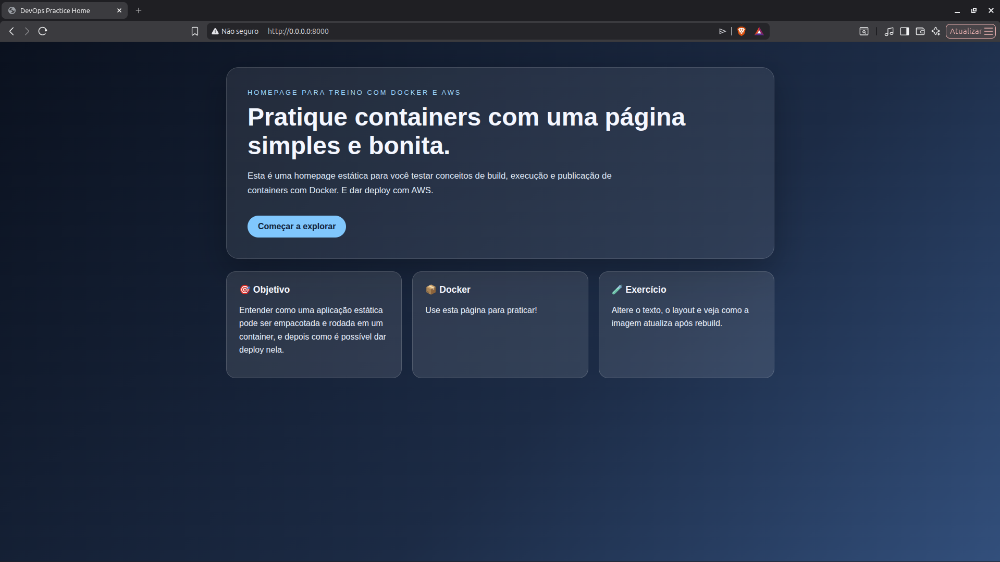
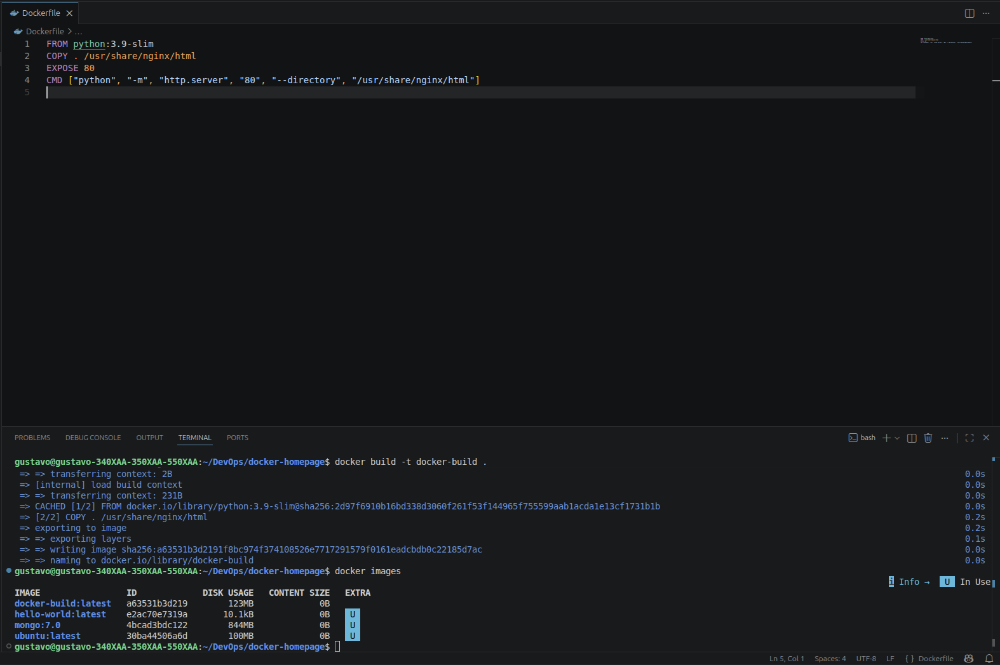
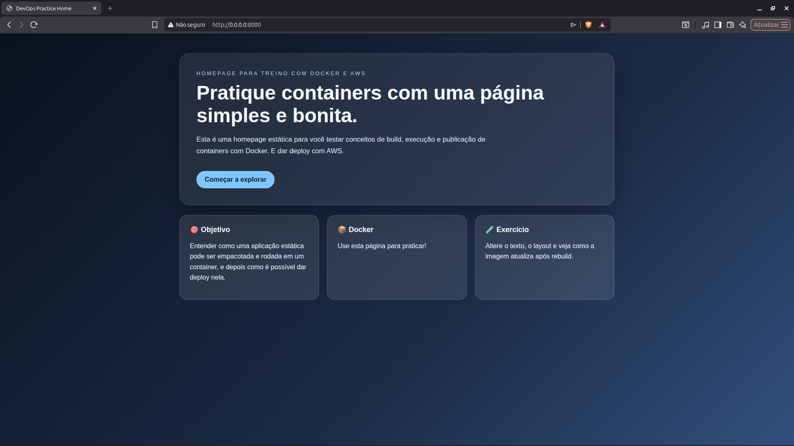
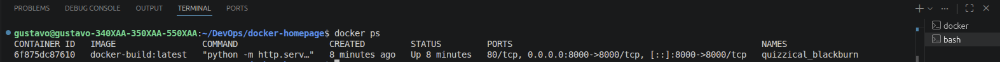

O objetivo deste projeto é criar uma página inicial para o Docker, demonstrando seu uso e funcionalidades. Depois dar deploy via AWS.

Requisitos: 
- Ter o Docker instalado
- Ter uma conta na AWS
- Ter uma página estática

Com um HTML, CSS simples, criei a página inicial do Docker, que será servida por um container Docker. A seguir, apresento os passos para construir e executar o container.

Feito o dockerfile (usei python por uma questão de afinidade), rodamos o build.
Em seguida rodamos docker images para verificar se a imagem foi criada com sucesso.

Por fim, rodamos o container e verificamos se a página está sendo servida corretamente.

Resultado:

Chegamos ao objetivo inicial, façamos algumas observações:

Na coluna PORTS, vemos que ele faz toda a leitura do mapeamento das portas, graças ao parâmetro -p 8000:8000, que mapeia a porta 8000 do container para a porta 8000 da máquina host. Isso significa que qualquer requisição feita para a porta 8000 da máquina host será redirecionada para a porta 8000 do container, onde o servidor web está escutando.

Antes de passarmos para o proximo objetivo, vamos trabalhar outras funcionalidades do docker.
Começando pelo DockerHub.

O primeiro objetivo foi alcançado, agora vamos para o próximo passo, que é fazer o deploy na AWS.

